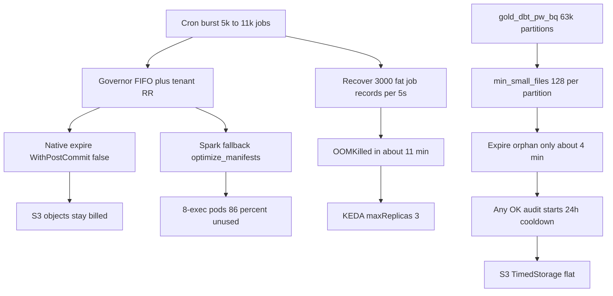

# Cryo cost rescue — make maintenance move S3 and Trino dollars

> For the implementing agent: **Round 2b first** (slim recover). Digest `fbe2ee0e` is live and still OOMKilling (~11 min, not 42s). Do not wait for a 4h soak. Do not enable fleet-wide native DEEP expecting TimedStorage to fall. Native expire is metadata-only (`WithPostCommit(false)`).

**Goal:** Stop worker OOM for real, then make Cryo **rewrite then expire-delete** on the tables that drive S3 GET and Trino CPU — not thousands of native expire Jobs that reclaim 0 bytes.

**Architecture:** Keep Cryo as a catalog-agnostic control plane. Native expire does **not** delete objects; Spark/Trino expire does. Compact is rewrite-neutral for TimedStorage until expire-delete/orphan runs **after** rewrite. Do not adopt Amoro AMS.

**Tech Stack:** Existing Python 3.12 backend, Go native engine (`engine-go/internal/ops/expire.go`), Helm [`deploy/helm/cryo/values-prod.yaml`](deploy/helm/cryo/values-prod.yaml), Grafana CUR for proof.

## Global Constraints

- No Airflow; sources ≠ destinations; Planner emits no SQL strings.
- Do not raise worker memory again (4Gi→6Gi→8Gi; still OOM).
- Do not flip `CRYO_ROI_GATE_SHADOW_MODE=false` to “save money.”
- Do not revert `native.keda.maxReplicas: 3` until recover is **actually** flat (not merely slower).
- Presets live in **Postgres**, not Helm.
- Trino **unused** EKS is out of Cryo’s control. Cryo only moves Trino **used**.
- Do **not** DEEP-orphan shared-S3 catalog aliases (RCA: orphan/DROP on an alias deletes prod).
- Do **not** enable fleet native DEEP as a storage lever. Native expire is metadata-only.

---

## Live evidence (2026-09-10, this session)

Cryo is running and still failing the north star.

**Workers (pre-fix, ~17:05 IST):** 3/3 KEDA replicas, all `lastState=OOMKilled`. One pod: **12 restarts in 77 minutes**. Kernel-verified: Anonymous heap **~1GB per 5s tick**, 140MB→8GB in ~42s. KEDA max **3**.

**Workers (post `c4567244`, digest `sha256:fbe2ee0e…`):** ReplicaSet `cryo-worker-ffb777fcf` started **12:04 UTC**. Last OOM **12:15–12:18 UTC** (exit 137) — **~11–14 min**, not 42s. Restarts **2–3**. Current RSS **139–150Mi** (post-restart). **Slower, not flat.** Recover still loads up to **500+500+2000 = 3000** full `_job_record` objects (plan jsonb + preset + N+1 autocomp/`last_maintained_at`) every 5s on every pod. That is the next leak of the same class.

**Scheduler:** ~1200m CPU / ~2.6–3.0Gi RSS — separate unbounded-housekeeping suspect; do not conflate with worker OOM.

**S3 (CDP 7 buckets, Grafana `cost-db`):** 30d **$12,039** — storage **$8,082** ($269/day), GET/HEAD **$2,878** ($96/day), PUT/LIST **$1,061** ($35/day). Mix is the same as August. Daily total still **~$440–475**. Gold 30d $3,248; bronze $3,510; silver $3,122. Slack 2026-09-08: gold **$140.84/day**, bronze **$155.84/day** — not falling.

**Trino `trino-db`:** latest billed day 2026-09-09 **$482** ($271 used / $210 unused). Mid-August post-burst dip (~$316–430) **did not hold**. Replica-2/3 workers still +12–14% WoW (Slack).

**Cryo namespace unused:** 2026-09-09 **$16 used / $101 unused = 86% unused**. Sep 1–9 ≈ **83% unused**. ~88% of unused is **untagged Spark driver/executor Jobs**. Live cluster is spawning Spark jobs that finish in **44–101s** (manifest rewrite, not 24TB compact) and at least one job with **8 executors** (destination config, not Helm’s 2).

**North star vs vitals mismatch:** `[cryo/reporting/impact_signals.py](cryo/reporting/impact_signals.py)` counts GB from `remove_orphan_files` / `optimize` only. Expire-only SUCCEEDED jobs inflate vitals success rate and start cooldown, while **GB freed stays 0**.

## Dollar physics (what actually moves CUR)

CDP 7 buckets ~**$12k/30d**: TimedStorage **$8.1k** ($269/d) + GET/HEAD **$2.9k** ($96/d) + PUT/LIST **$1.1k** ($35/d). Trino ~**$482/d** = **$271 used** / **$210 unused**. ~316 TB × ~$23/TB-mo is already an ~$7.3k TimedStorage floor. Cryo can only cut the **extra** snapshot-pinned / orphan / duplicate / small-file tax, plus GET and Trino **used**.

- **Expire snapshots:** Unpins files from the snapshot graph. Native (`engine-go/internal/ops/expire.go` `WithPostCommit(false)`) does **not** delete objects. Spark/Trino expire **do**. TimedStorage does not fall on the native path until orphan LIST or a Spark/Trino expire-delete after rewrite.
- **Remove orphan files:** Deletes objects **never in any snapshot** (failed writes). DEEP-only in planner. Full-prefix LIST (Tier-1). Native execute currently **preview LIST + execute LIST + Open/Stat every path** for byte metrics — extra HEAD/GET even when reclaim = 0. Confirmed 57.7% of tables got **more HEAD after maintenance**.
- **Compact / rewrite data files:** Nearly **rewrite-neutral** for live TimedStorage. Net GB drop = merged deletes + later expire of replaced small files. : ~258 GB from a 24 TB Spark rewrite. **Primary GET + Trino-used lever** (fewer splits). Compaction itself is a PUT burst. `gold_dbt_pw_bq` rebounded to hundreds of thousands of files / **378k–476k PUTs/day** after a one-off compact.
- **Rewrite manifests:** Tiny storage. Cuts planning GETs. Native cannot run it → Spark Job per DEEP table (the 44–101s 8-exec Jobs).
- **Rewrite position deletes:** Tiny storage. Cuts MOR read GET + Trino CPU. Spark only; Trino raises. Native always fallback.
- **Compute stats / Puffin:** Zero TimedStorage (adds blobs). Cuts GET/Trino via skip. Planner requires `params.compute_statistics` (default false). Global `compute_statistics_enabled` only refreshes benefit scores.

Official refs: [Iceberg maintenance](https://iceberg.apache.org/docs/latest/maintenance/), [AWS Iceberg storage](https://docs.aws.amazon.com/prescriptive-guidance/latest/apache-iceberg-on-aws/best-practices-storage.html). Amoro minor/major is the same physics as a preset split, not a new op.

---

---

## Diagnosis (why Cryo is not beating Amoro / not cutting cost)

Cryo’s product idea is ahead of Amoro on load-aware admission, partition planning, and explainable ROI. **Production proof is behind.** The failure is not “missing compaction SQL.” It is four compounding loops:

1. **Control plane OOM under backlog (partially closed, not done).** Worker recover queued then running/admitted scans are **capped** (`68bc82eb`, `c4567244`) but still OOM at ~11 min because each tick materializes up to 3000 **fat** `_job_record`s. Governor [`cryo/queue/reconcile.py`](cryo/queue/reconcile.py) `list_running` / `list_admitted` remain unbounded. KEDA still counts native RUNNING.
2. **Native expire does not delete S3 bytes.** [`engine-go/internal/ops/expire.go`](engine-go/internal/ops/expire.go) `WithPostCommit(false)`. Planner still emits expire on LIGHT/STANDARD without orphan. Native STANDARD = metadata-only. Enabling `default-native-deep` without rewrite **and** without Spark expire-delete will LIST the fleet and not drop TimedStorage.
3. **`gold_dbt_pw_bq` never plans OPTIMIZE.** Table has 58k small files so the **table-level** gate passes (`min_small_files=128`). [`_candidate_partitions`](cryo/planner/planner.py) then requires **each** partition ≥ 128 small files. 63,694 partitions → **~1 small file/partition** → `"Skipped optimize: no renderable partition candidates met the threshold."` Full-table OPTIMIZE blocked (24549 GB ≫ `chunk_size_gb` 100). “success” in ~244s is expire+orphan only. Adding `optimize` to the preset **does not rewrite this table**.
4. **`commits_per_day` zeros after any maintenance job** ([`detect_streaming_from_history`](cryo/scanner/signals.py) lines 60–61). True velocity ~123 commits/day would retain 1 day; live path keeps **3 days**. Streaming-aware retention never fires on tables Cryo actually touches.
5. **The expensive tables are not the ones getting rewrite.** Slack gold GET 2026-09-07: `mview.gold_dbt_test_results` (0→7.8M GET), `gold_dbt_video_stats_v3`, `*_evolving`. MOR: if OPTIMIZE is skipped, [`convert_deletes` is also skipped](cryo/planner/planner.py) (“planned optimize already rewrites”) — **neither runs**. Dark-table campaign does not touch these.
6. **Intelligence is scored, then ignored at admit time.** Redis is run-age FIFO. `fleet_budget_gb` default `None`. Autopilot is ON but re-SETs the same properties (does not update `TableStats.raw`) and those OK audits start cooldown. `reclaimable_bytes` heuristic is **0** when `total_snapshots > 200` (`cost_scan_max_snapshots`) — so even reclaim×query ranking is blind on the biggest tables.

`[cryo/worker/worker.py](cryo/worker/worker.py)` `_ensure_table_lock` (1184–1187) **returns and runs anyway** if another job holds the lock. Recover can adopt a live execute. That matches dual logs on `cdp.user360.silver_user360`.

Do **not** treat Cryo-namespace unused % as the S3/Trino problem. Rightsizing Spark/native Jobs is Wave 2; it does not shrink TimedStorage. Tightening the $250 cost ceiling would **pause admission** and make S3 worse.

---

## Approaches (pick one sequencing; recommended is A)

**A — Stability then rewrite-then-delete then brains (recommended).** Round 2b slim recover until OOM is gone. Wave 1 spread-optimize + Spark expire-delete on hot GET/TB tables. Wave 2 admit-by-value + skip no-op Jobs. Wave 3 stats/layout canary. Wave 4 unique-location drops + gold IT.

**B — Enable fleet native DEEP while workers still OOM.** Thousands of LIST/HEAD Jobs, metadata-only expire, no rewrite on 63k-partition tables. Makes HEAD and unused worse. Rejected.

**C — Feature race vs Amoro.** WAIR, PTO auto-apply, AMS. Does not move this month’s CUR. Rejected as first move.

---

## Wave 0 — Stop the worker OOM cascade (rounds, same pattern)

Same class of bug, same fix, one missed call site at a time. Do **not** bundle lock/KEDA/Trino into the next patch while soaking `fbe2ee0e`.

### Round 1 — shipped `68bc82eb`

`recover_orphaned_jobs` `list_queued_jobs(limit=2000)`. Reduced queue depth, **did not** stop the ~1GB/5s heap climb.

### Round 2 — shipped `c4567244`, digest `sha256:fbe2ee0e…` live

`list_running_jobs(limit=500)` oldest `started_at`, `list_admitted_jobs(limit=500)` oldest run `created_at`. 13 tests. This was the kernel-verified leak (RUNNING includes native jobs recover later filters via `_is_native_watcher_owned`).

**Soak of `fbe2ee0e` failed the “flat” bar.** Last OOM 12:15–12:18 UTC (~11–14 min after 12:04 start), 2–3 restarts. Do **not** wait 4h. Do **not** revert maxReplicas yet.

### Round 2b — NEXT (same class: recover still too fat)

Caps without slim rows are not enough. `list_running_jobs` still returns `[ _job_record(session, job) for job in jobs ]` with eager run+preset, **full `job.plan` jsonb**, plus N+1 `_last_maintained_at` and `_table_autocomp_summary` per row. Recover concatenates running+admitted+queued → up to **3000 fat objects every 5s × 3 pods**.

- Recover-only DTO: `id, status, engine_ref, table_id, destination_id, started_at, dispatch/native flag`. Load full record only after adopt.
- SQL `WHERE` exclude native watcher-owned RUNNING (today filtered in Python **after** materialize).
- Drop TypeError unbounded fallback ([`orphan_recovery.py`](cryo/worker/orphan_recovery.py) 207–210, 224–227).
- Until slim: lower caps (running 50, admitted 50, queued 200). 500+2000 was copied from governor 30s reconcile, not worker 5s.

Tests: spy that recover listing does not call `_job_record` / does not load `plan`; SQLJobStore slim query; TypeError does not unbounded-scan.

**Done when:** 0 OOM through a cron burst; RSS flat for hours not minutes.

### Round 3 — after 2b is flat

Governor [`cryo/queue/reconcile.py`](cryo/queue/reconcile.py) still calls the **same** list methods unbounded every ~30s wave, while queued/deferred reconcile on this file was already capped 2026-09-02:

- `reconcile_stale_running_jobs` line **188**: `for job in list_running:` — no `limit=`
- `reconcile_stuck_admitted_jobs` line **275**: `for job in list_admitted:` — no `limit=`

Queued/deferred already use `_MAX_QUEUED_RECONCILE_PER_WAVE=2000` and `_MAX_DEFERRED_RECONCILE_PER_WAVE=500`. Round 3 copies that pattern onto running/admitted (500, oldest-first). Tests in [`tests/test_queue_reconcile.py`](tests/test_queue_reconcile.py) mirroring `TestReconcileQueuedJobsBounding`.

Governor is 1 replica / 30s. This is governor stall risk, not the worker 5s leak — unless KEDA still scales extra fat-recover workers (Round 2b + Round 4 KEDA metric).

### Round 4 — not this class (after Round 3)

- Fail-closed `_ensure_table_lock` + `acquire_job_owner` in [`cryo/worker/worker.py`](cryo/worker/worker.py)
- KEDA [`_worker_scale_metric`](cryo/cli.py) currently `count(*) WHERE status IN ('admitted','running')` — includes native RUNNING
- Trino [`engine.py`](cryo/engines/trino/engine.py) never calls `on_engine_ref` until `cursor.execute` returns

Do not raise 8Gi. Do not keep maxReplicas=3 as a cost win.

---

## Wave 1 — Make jobs delete S3 bytes (coverage × rewrite semantics)

Code + **live DB preset changes**. Helm cannot answer preset truth. **Putting `optimize` on a preset is not sufficient** if the planner skips it.

**1. Live audit:** port-forward `cryo-api` ([`docs/AGENT_HANDOFF.md`](docs/AGENT_HANDOFF.md)). `/api/v1/vitals`, presets, unmatched gauge, `gold_dbt_pw_bq` (`1ae85c5b-...`) last plan **notes** (look for `Skipped optimize: no renderable partition candidates`). Confirm `default-native-deep` operations; do **not** blindly enable it as fleet DEEP (see native expire + no-op Jobs).

**2. Spread-small-file OPTIMIZE (the gold_dbt_pw_bq gate).** [`cryo/planner/planner.py`](cryo/planner/planner.py) `_optimize_operations`: table-level `small_files_count ≥ 128` can pass while `_candidate_partitions` requires **each** partition ≥ 128. Fix: pack partitions by **cumulative** small files / files-per-partition toward target file size, even when none individually meet 128; or lower `min_small_files` when `total_partitions` is huge. `scanner_max_partitions_per_table` default 5000 truncates this table’s 63k partitions — keep worst-by-small-files **and** delete-skew partitions. Full-table OPTIMIZE stays forbidden above `chunk_size_gb`. Tests: fixture with 1000 partitions × 2 small files, `small_files_count=2000`, `total_size_gb=500` → plan emits partition-scoped OPTIMIZE chunks, not skip.

**3. Native expire is metadata-only.** Do not expect TimedStorage to fall from native expire. For hot writers: **Spark/Trino rewrite then Spark/Trino expire-delete** (Iceberg default deletes unreferenced files). Native orphan LIST is for failed-write garbage, not a substitute for rewrite. Optional later: native `WithPostCommit(true)` **after** rewrite, instead of a second full-prefix LIST of 24 TB.

**4. `commits_per_day` after maintenance.** [`cryo/scanner/signals.py`](cryo/scanner/signals.py) returns `(False, 0.0)` if `maintenance_job_since_previous`. Walk older history / use `first_snapshot_at` vs `last_snapshot_committed_at`. Until shipped: pin `gold_dbt_pw_bq` `retention_days=1`. Backlog `*4` must not keep 3-day retain when snapshot count is already critical (382 vs threshold 100).

**5. Cooldown and success lie.** Restrict `_last_maintained_at` to reclaim actions matching `impact_signals._RECLAIM_ACTIONS`. Populate `TableCandidate.last_maintained_at`. Mark PARTIAL when planned optimize was skipped. Do not count `apply_table_properties` OK.

**6. Skip no-op native Jobs.** Planner always emits expire. Native returns immediately if `beforeCount <= retainLast` **after** the Job exists (512 MiB request, LIST/HEAD). Skip dispatch when `total_snapshots ≤ retain_last+1` and reclaim/orphan estimate is 0. One orphan LIST, not preview+execute+Stat. Wave 1 enabling catchall DEEP **without** this skip makes unused and HEAD worse.

**7. Hot GET tables — Spark MOR path.** Dedicated finishing rewrite for:
- `unified_bq.gold_dbt_pw_bq` (TimedStorage + PUT; spread-optimize + no 240 min deadline)
- `mview.gold_dbt_test_results` (Slack 7.8M GET DoD; delete_file_pct class — `rewrite_position_deletes` / `force_convert_deletes`, **not** native)
- `mview.gold_dbt_video_stats_v3` (queried 406 GB vs parent 187 GB — compact **v3**, don’t assume parent compact helps)
- live `*_evolving` writers from Slack (`results_evolving`, `users_evolving`, …)

If OPTIMIZE is skipped, do **not** also skip convert_deletes. Fail the job if Spark fallback does not run. `gold_dbt_test_results_backup` (749 GB) is Wave 4 drop, not compact.

**8. Native Spark fallback must fail the job** if OPTIMIZE/delete-rewrite was planned and fallback did not run.

**Done when:** plan notes on `gold_dbt_pw_bq` show OPTIMIZE chunks; a Spark optimize step **finishes**; north-star GB/day > 0 on DEEP/Spark-expire days; GET tables show file/delete-file drop held 7d.

---

## Wave 1b — Autopilot must stop fighting cooldown

`CRYO_PROPERTY_AUTOPILOT_ENABLED=true` applies tier1 keys via PyIceberg. Gaps:

- Does **not** update `TableStats.raw.iceberg_properties` (human API does). Next hourly tick re-SETs → extra metadata commits + OK audits → cooldown (Wave 1 item 5).
- `previous-versions-max=10` / `delete-after-commit` only recommended when snapshots ≥ 50 or manifests ≥ 100. Most tables keep Iceberg’s **100** metadata versions (HEAD/GET of `metadata.json`).
- `write.target-file-size-bytes` does not rewrite existing small files (needs Wave 1 OPTIMIZE).

**Do:** skip no-op after reading live props; persist stats like the API; drop the 50-snapshot gate on query-hot tables. Do not treat autopilot as a GET/storage substitute for rewrite.

---

## Wave 2 — Admit by value + cut Cryo unused (does not throttle OPTIMIZE)

**Admission:** Redis score = `_combined_priority_weight` (reclaimable GB + `query_count_30d` + projected savings), not `fifo_priority(run.created_at)`. Tenant RR as tie-break. Set a real `fleet_budget_gb` so `pack_fleet_budget` is not a no-op. ROI stays **shadow**.

**Reclaim estimates are currently a lie on the biggest tables:** `cost_scan_max_snapshots=200` → `_heuristic_fallback` sets `reclaim_expire_bytes=0` when snapshots > 200 (`gold_dbt_pw_bq` had 382). `cost_full_scan_every_hours=168`. Wave 2 ranking without forcing metadata-tier expire accounting on top-N TB / high-GET still prefers whoever last got a LIST. Force `cost_full_scan` / expire-delta accounting on that set.

**Spark unused (~$833/9d empty-tag bucket):** `_dispatch_fallback_operations` must `with_table_stats` + [`sizing.py`](cryo/engines/spark/sizing.py). Manifests-only: 1 executor ~500m/1024Mi. Cap destination `executor_instances` (live **8**). Skip `optimize_manifests` **before** native_admit queues fallback when `manifest_count` is low. TTL 3600s → ~300s; drop `do-not-disrupt` after Succeeded.

**Native packing:** do not bump tiny/missing-stats rewrites to 2.7–5.3Gi. Skip tiny expire/orphan Jobs (Wave 1 item 6). One orphan LIST; **no Stat/Open for metrics**.

**HEAD as a KPI:** 57.7% of tables got more HEAD after maintenance. Track `head_requests_30d` (column exists, migration `20260908_0047`). Success includes HEAD not rising fleet-wide after DEEP.

**Trino OPTIMIZE writers:** [`session_setup`](cryo/engines/trino/sql.py) always `task_min_writer_count=8` and `writer_scaling_min_data_processed='32MB'` — can **increase** file count on small partitions (PUT now, GET later). Size to chunk GB; 1–2 writers unless rewrite GB is large.

**Scanner:** HPA minReplicas 3 → 1 while `scanner.jobDispatch.enabled`.

**Done when:** unused/used trending from ~6× toward <2× **without** pause; Spark Jobs no longer default 8×2Gi; HEAD/day on maintained tables not up.

---

---

## Wave 3 — Intelligence that actually executes (Trino used-cost)

Only after Waves 0–1. Scores without execute do not move CUR.

- `params.compute_statistics: true` on query-hot presets **after** compact in the same plan (Puffin matching files). Spark/Trino fallback required.
- Layout/PTO execute **canary** on high `query_count_30d` ( class: wrong partition → TB/week scanned). Sort-order is a rewrite.
- Wire AutoComp MOOP into Wave 2 admit order.
- Amoro **per-table slot quota** inside a destination group ([`docs/amoro-evaluation.md`](docs/amoro-evaluation.md) §3.1) so `gold_dbt_pw_bq` cannot starve 10k expires and vice versa.
- Generational **presets** (not a planner rewrite): hot writers → frequent OPTIMIZE; fleet → weekly DEEP orphan+manifests.
- **Bucket predicates:** `DEFAULT_RENDERABLE_CAPABILITIES` is BASIC_COMPARISON only; `bucket(N)` partitions are skipped. Add `BUCKET_FILTER` render or full-table OPTIMIZE only for small bucket tables. Partition-evolution UI is not a cost lever until execute exists.
- **Yelp partition-access:** `PartitionAccessDaily` already lands. Operator-gated expire/drop of partitions with long `days_since_last_access` where time-travel SLA allows. Yelp’s −33% storage was **acting**, not charting. Do not auto-write S3 storage-class from this yet.

**Defer:** WAIR per-file utilization (QueryLog empty in prod), Flink, Amoro AMS, Paimon, fleet partition-spec auto-evolution, S3 Tables managed compaction.

---

---

## Wave 4 — Platform levers Cryo cannot code (still required for drastic TimedStorage)

- S3 Intelligent-Tiering on **gold after compact** (bronze INT exists; gold had zero `INT-*` in Aug). FA tier is Standard price. Monitoring **$0.0025/1,000 objects/month** — uncompacted small files can net-negative.
- **Named copies with unique locations** (human-gated DROP, not orphan of aliases): `cdp_revenue.silver_infinite_practice_result_questions_temp` ~5 TB next to a live parent; `mview.gold_dbt_test_results_backup` 749 GB vs live 80 GB; `user_experience.gold_results_backup` ~1.1 TB. Combined name-pattern set **~18 TB** ([`docs/TABLE_DEDUPLICATION_DESIGN.md`](docs/TABLE_DEDUPLICATION_DESIGN.md)). Verify unique S3 prefix vs shared-S3 RCA.
- Lifecycle on `pw-data-cdp-prod-temp` (~27 TB, **not Iceberg** — table maintenance will never touch it).
- Finish ~106 ghost catalog deactivations (`location IS NULL` / 404) so they stop eating scan/expire slots. Deactivate ≠ S3 delete.
- Glue table optimizers **only** for tables actually in Glue Catalog — not a parallel writer on `gold_dbt_pw_bq`.
- Payer CUR user-tags `eks-workload-name` / `cryo-engine` .
- Trino coordinator/gateway **request** trims — not Cryo.

---

---

## What “success” looks like (do not declare win from vitals)

- Worker OOM: today 2–3 kills / ~11 min on `fbe2ee0e` → target 0 through a cron burst
- North-star GB/day: expire-only ≈ 0 → > 0 on Spark-expire/orphan days (native expire alone does not count)
- `gold_dbt_pw_bq`: plan emits OPTIMIZE chunks; files held 7d (not rebound to 190k+)
- Slack GET tables: `gold_dbt_test_results` / `gold_dbt_video_stats_v3` file or delete-file count down
- S3 7-bucket daily: $440–475 → down vs this baseline (TimedStorage lags 1–2 weeks)
- HEAD: not up on 57%+ of tables after maintenance
- Trino **used** $/day: ~$271 (Sep 9) → down vs same weekday; ignore unused
- Cryo unused ratio: 6.3× → < 2× used, not via pause

Append every cost pull to [`docs/cost-tracking/daily-cost-log.csv`](docs/cost-tracking/daily-cost-log.csv) (last cryo row **2026-08-10**). Update [`docs/AGENT_HANDOFF.md`](docs/AGENT_HANDOFF.md) so the next session does not re-raise memory or re-enable fleet native DEEP as a storage fix.

---

---

## Competitive stance (after the machine works)

Stay the **open, catalog-agnostic maintenance control plane**. Amoro’s catalog+Flink+streaming is a different product. Cryo wins if Verified Maintenance Yield is public: table, files before/after, bytes reclaimed, GET/HEAD/scan before/after, engine, duration. Glue/S3 Tables/Dremio Reflections are not this month’s CUR path. Do not grow more UI/AI surfaces until Waves 0–2 move CUR.